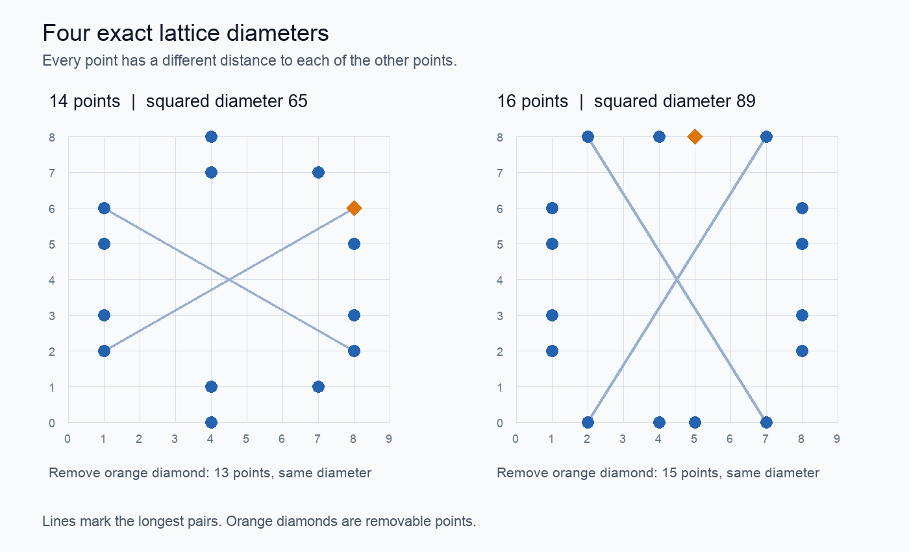

# A386493: four exact lattice diameters

**a(13) = a(14) = 65; a(15) = a(16) = 89.**

[OEIS A386493](https://oeis.org/A386493) asks for the smallest squared diameter
of n integer lattice points whose distances from each chosen point are all distinct.



The displayed sets attain 65 and 89. Removing the orange diamond gives the
13- and 15-point sets. Exhaustive searches exclude 13 points at squared diameter
64 and 15 points at 85; 86–88 cannot be squared lattice distances.

[Read the proof](PROOF.md) · [Point coordinates](verification/witnesses.json) · [Verifier and source code](verification/)

From the repository root, with Python 3.9+ and Rust installed:

```sh
python3 oeis-extensions/A386493/verification/verify.py
```

No extra Python packages or SAT solver are needed. The command checks all four
constructions and completes three exhaustive searches, including an independent
15-point exclusion. This is a computational proof, not a proof-assistant certificate.
